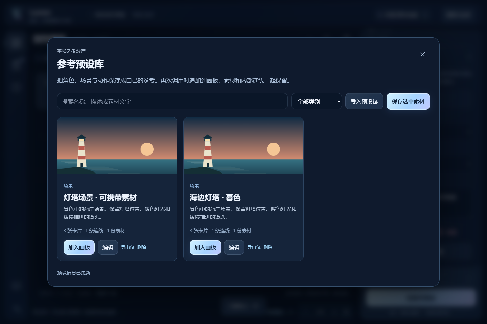

# Lumen · 流光

**把文字、参考素材和三维预演组织成一个镜头。**

Lumen 是面向本地 MiniMax H3 的 Windows 视频创作工作台。固定空间画板、真实模型输入预览、全窗口 3D Previs、素材回填和可复用预设在同一个桌面应用中。双击一个图标打开，关窗即退出并关闭它启动的生成引擎。

当前版本 **4.1.1**。应用源代码采用 MIT 许可；模型、引擎和第三方内容遵循各自许可。仓库不携带模型权重、个人素材或生成历史。



## 安装与启动

支持 **Windows 10/11 x64**。生成视频需要受支持的 NVIDIA GPU 和驱动；画板、素材管理与 3D 预演可先独立使用。Windows on Arm / RTX Spark 尚未完成本项目实机验证。

1. 下载 [最新源码](https://github.com/JingDuuu/Lumen/archive/refs/heads/main.zip)，解压到可写目录。
2. 安装 [Python 3.12 x64](https://www.python.org/downloads/windows/) 和 [Git for Windows](https://git-scm.com/download/win)。
3. 双击 **Setup-Lumen.cmd**，安装应用及引擎依赖并建立桌面快捷方式。首次安装需要联网；只用编辑器可运行 `setup.ps1 -EditorOnly`。
4. 双击桌面的 **Lumen**，或目录中的 **Start-Lumen.cmd**。
5. 在应用的模型设置中阅读模型许可，主动下载所需 H3 模型。支持进度、取消、续传和完整 SHA-256 校验，也提供 **Install-H3.cmd**。

已有 ComfyUI 可通过 `lumen.local.json` 指向现有安装，不必重装或复制权重。配置见 [lumen.example.json](lumen.example.json)，步骤见 [安装指南](PORTABLE_INSTALL.md)。安装脚本不会自动下载数十 GB 的模型。

两个生成模型加公共编码器/解码器共约 **63.44 GB**（十进制），只装一种生成模式约 **42.47 GB**；还需预留依赖、临时文件与素材空间。低显存运行依赖卸载与交换，速度会受明显影响。

## 创作流程

- **固定空间画板**：人物、场景、动作与镜头、分镜与 3D Layout，可新增自定义空间。卡片直接显示用途；图片双击预览，可复制真实图像或下载原图。
- **命名预设库**：把角色、场景或多张关联卡片保存为预设；搜索、分类、改名、再次加入画板。内部连线和媒体依赖一起保存，可导入/导出独立预设包。
- **实际模型输入**：生成前核对图片、视频有效截取、参考声音、角色标签、连线关系、完整提示词及结构化数据。连线会编译成引用具体素材的文字指令。
- **任务进度**：分别显示排队、加载、编码、采样、解码与保存；依据真实采样速度估计剩余时间，信息不足时明确显示无法可靠估时。支持取消与配置回填。
- **成片素材库**：播放、搜索、星标、标签和文件位置；回填当时的画板、参考内容与参数，继续迭代。

H3 Ref2VA 支持最多 **9 张图、3 段视频及视频同期声音**。FL2VA 支持首帧、尾帧和三个中间位置的图片引导。两种模式不能在一次生成中混用；界面会说明冲突。每次参考的有效范围以输入预览为准。

## 3D Previs 工作区

占满应用的轻量三维编辑器，也可进入系统全屏：

- Outliner 多选、分组、父子挂接、显示与锁定；Details 编辑变换及一键重置。
- UE 风格右键飞行、W/A/S/D、Q/E、Shift 加速；F 聚焦、Alt+左键环绕、中键平移。未按右键时 W/E/R 切换变换工具。
- 40 种构图对象、71 个原创姿态、8 种手势、12 个参数表情；选中角色即显示可直接拖动的 IK 控制点，也可精调 FK、体型和左右手。
- Sequence 逐属性关键帧、插值、拖动、多选删除；Space 播放/暂停，K 快速记录当前状态。相机支持焦距、朝向和曲线导轨。
- 四套本地 CC0 HDR、灯光、基础材质、曝光、网格、世界轴、构图线与简单/质量渲染。
- 场景、模板、Prefab、最近文件与便携场景包；Prefab 保留子层级、角色状态和动画，插入时重新分配内部 ID。
- GLB/glTF、OBJ、FBX、Alembic 交换；FBX/ABC 等由可选的本机 [Blender](https://www.blender.org/download/) 后台转换，有进度和取消。
- 输出 PNG 或逐帧采样的 24fps MP4 回到画板，作为 H3 的真实图像/视频参考。

H3 接收图像像素、视频帧和文字，**不直接读取三维场景 JSON、骨架或时间线**。OBJ 不保留动画；ABC 是几何缓存；第三方约束、材质和相机属性无法保证无损互通。Lumen 场景包保留本应用完整编辑状态。它不包含 UE 物理模拟或蓝图执行系统。

## 快捷键

| 画板 | 操作 |
|---|---|
| Ctrl+Z / Ctrl+Shift+Z | 撤销 / 重做 |
| Ctrl+C / Ctrl+X / Ctrl+V | 复制 / 剪切 / 粘贴卡片及内部连线 |
| Ctrl+D | 复制所选卡片 |
| Ctrl+S | 保存草稿并查看全部卡片 |
| F / Home | 聚焦所选 / 全部 |
| Ctrl+A / Shift 单击 | 全选 / 多选 |
| Space 拖动 / 中键 | 平移画板 |
| Delete / Esc | 删除所选 / 结束当前操作 |

文字输入中保留系统编辑习惯。画板自动保存，右键菜单提供常用操作。

## 让其他模型操作 Lumen

应用提供本地 HTTP API、机器可读能力发现与 Schema，以及 JSON CLI。支持画板、媒体、预设、三维文档、Prefab、转换任务、输入预览、生成与取消。

```powershell
.\lumen.bat start
.\lumen.bat status
.\lumen.bat discover --json
.\lumen.bat board get --json
```

准确命令和可运行示例见 [Agent 接入指南](docs/AGENT_GUIDE.md)，也可运行 `lumen.bat --help`。API 仅监听本机地址。建议先发现能力、读取状态、预览输入，再提交生成。画板自动化编辑使用版本校验和幂等请求，避免覆盖新的修改。

## 数据与备份

新安装默认把个人数据放在 `data/`，引擎放在 `runtime/ComfyUI/`，依赖放在 `.venv/`。模型放在配置的 ComfyUI `models/` 下。已有 `ComfyUI/studio` 安装继续使用原位置，不迁移旧资料。

备份配置中的 `data_dir`、`input_dir`、`output_dir` 和 `lumen.local.json`。预设 ZIP/场景 ZIP 适合单独迁移内容。仓库忽略本地数据、下载碎片、日志和模型；分享预设包前请确认其中素材可分享。

## 性能与边界

- 建议从 608×352、2 秒、8 步试片开始；按 `17k+5` 帧、24fps 对齐，输入 2 秒得到 56 帧（约 2.33 秒）。试片不代表最终质量。
- 短片耗时不能外推到高分辨率长视频；输入数量、显存、卸载策略和冷启动都会影响速度。
- 参考关系能指导生成，但不保证身份、动作、构图或声音严格一致，仍需试片与迭代。
- 本地基础模型不包含官方完整 Context-IR / Regenerate-2K 托管工作流。
- 关窗停止 Lumen 拥有的引擎及未完成任务，保留配置，但不能从中间采样步续算。内部端口被其他服务占用时报告冲突，不终止无关进程。

## 开发与许可

开发和测试见 [DEVELOPMENT.md](docs/DEVELOPMENT.md)，更新见 [CHANGELOG.md](CHANGELOG.md)。界面与 CLI 共用后端工作流、验证和任务状态。

[MIT 应用许可](LICENSE) · [第三方与模型许可](docs/THIRD_PARTY.md) · [MiniMax H3](https://huggingface.co/MiniMaxAI/MiniMax-H3) · [ComfyUI](https://github.com/Comfy-Org/ComfyUI)
